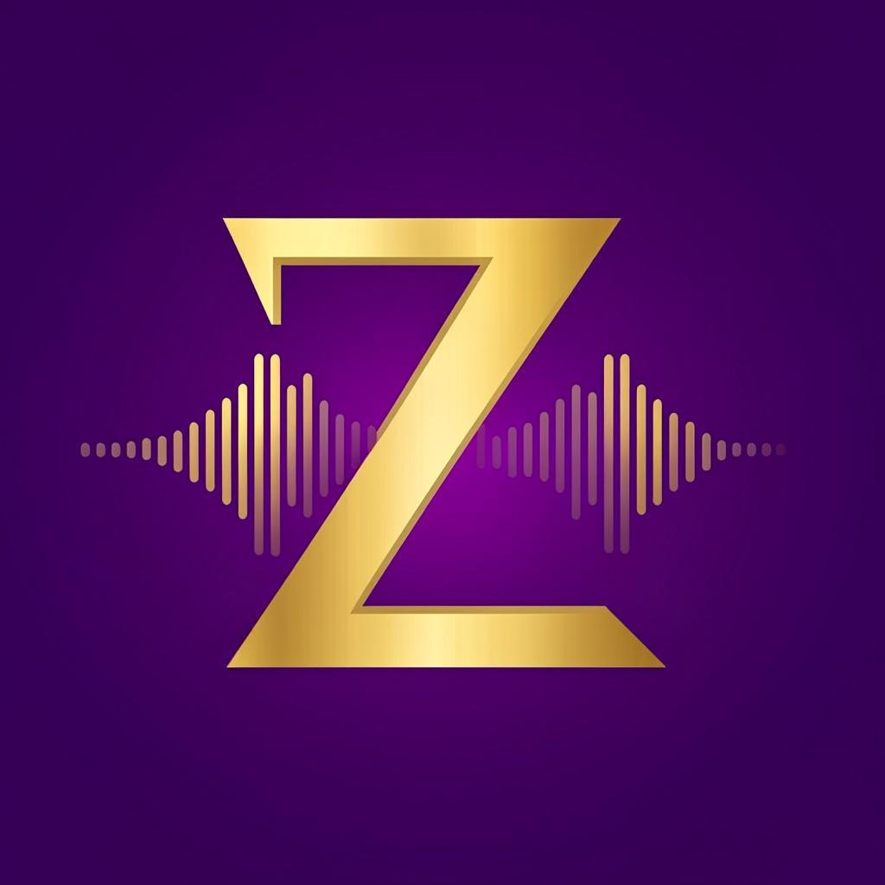
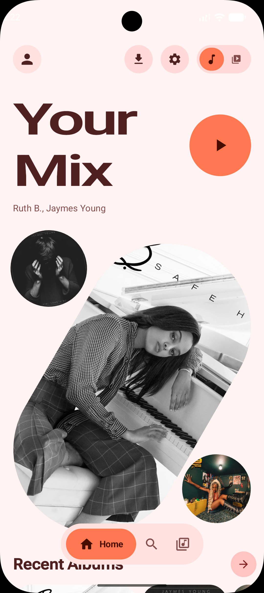
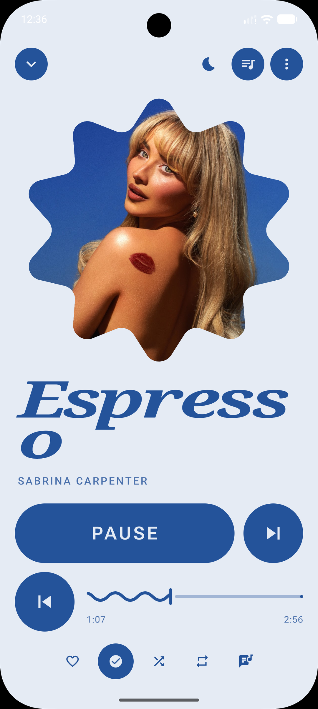
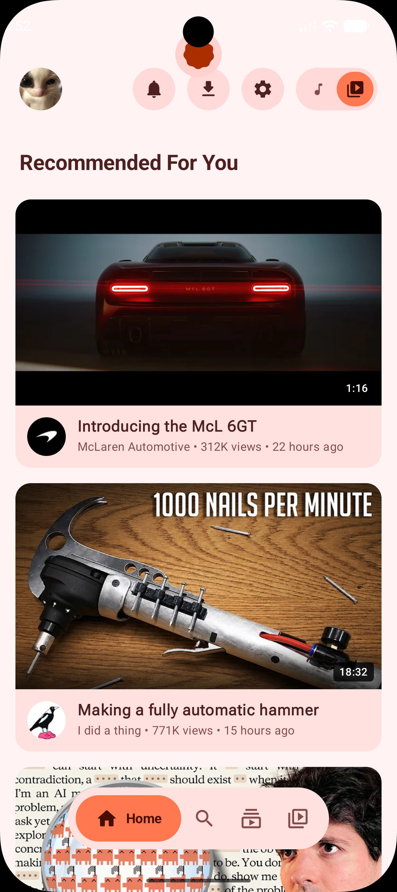
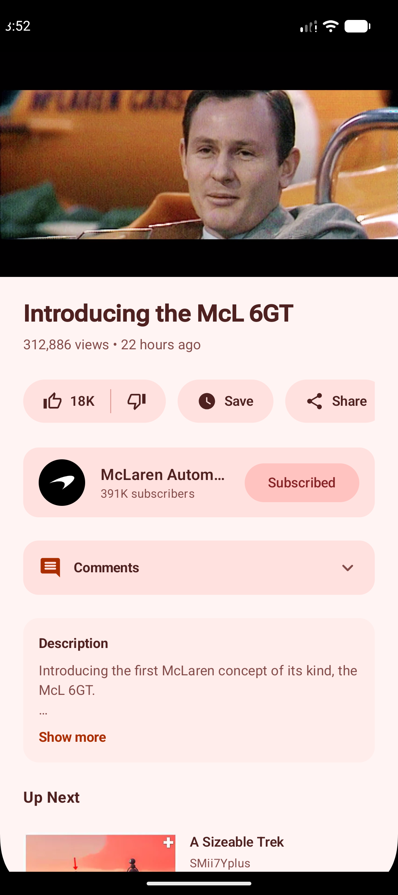

<p align="center">
  
</p>

<h1 align="center">ZYROX MUSIC</h1>

<p align="center">
  <b>Music & video, one app. Powered by YouTube Music — built for Android.</b>
</p>

<p align="center">
  <a href="https://github.com/KMJ-TIPS/ZYROX-MUSIC/releases/latest"></a>
  <a href="https://github.com/KMJ-TIPS/ZYROX-MUSIC/releases"></a>
  <a href="https://kmj-tips.github.io/ZYROX-MUSIC-DOWNLOADER/"></a>
</p>

<p align="center">
  
  
  
</p>

<p align="center">
  
</p>

---

**ZYROX MUSIC** combines a complete music player and a complete video player in one app. Switch modes from Home and the feed — search, library, and the player adapt with it.

It works without an official YouTube API key, and an account is optional. Search, playback, downloads, local playlists, likes, subscriptions and recommendations all work on-device; signing in adds your YouTube feeds, library, history, comments and other account features.

<p align="center">
  
  
  
  
</p>

## ✨ Features

- 🎵 **Music player** — YouTube Music streaming, editorial home, Your Mix, artist radio, synced lyrics, sleep timer
- 🎬 **Video player** — recommended feed, watch page with comments, Shorts, live streams, frame interpolation (smooth motion)
- 📥 **Downloads** — audio & video offline with per-format quality selection, private downloads, download manager
- 🎨 **Zyrox Royale theme** — signature purple & gold palette out of the box, plus Material You dynamic color and 30+ palettes
- 🎛️ **10 player styles** — Editorial, Hero, Bento, Canvas, Gesture, Morph, Dial, Sticker, Poster and Classic layouts
- 📱 **Home screen widgets** — Pulse, Lineup, Bloom, Orbit, Vinyl and Pixel, all resizable
- 🧠 **Listening stats** — wrapped-style statistics, history, taste setup for better recommendations
- 🔊 **Quality controls** — streaming quality per network, loudness normalization, SponsorBlock, return dislike
- 🪟 **Android Auto, Discord Rich Presence, Last.fm scrobbling** — all built in
- 🔒 **App lock & daily limit** — optional listening time limits with lock screen
- 🌙 **AMOLED black, dynamic color, palette styles** — the look is yours

## 📥 Download

Grab the latest APK from **[GitHub Releases](https://github.com/KMJ-TIPS/ZYROX-MUSIC/releases/latest)** or the fancy **[Download Page](https://kmj-tips.github.io/ZYROX-MUSIC-DOWNLOADER/)**. ZYROX MUSIC requires Android 11 or newer.

| APK | Use it for |
|---|---|
| `arm64-v8a` | Almost every modern Android phone. **Start here.** |
| `armeabi-v7a` | Older 32-bit devices. |
| `universal` | A larger build containing both architectures. |

Android will ask for permission to install an app from outside the Play Store. After installation, the in-app updater can check GitHub Releases and pick the correct APK automatically.

## 🚀 Build it yourself

```bash
git clone https://github.com/KMJ-TIPS/ZYROX-MUSIC.git
cd ZYROX-MUSIC
./gradlew assembleRelease   # release build (minified + shrunk)
./gradlew assembleDebug     # debug build
```

Requirements: Android SDK (API 37), JDK 17+. ABI splits produce `arm64-v8a`, `armeabi-v7a` and `universal` APKs. Release signing reads `KEYSTORE_PASSWORD`, `KEY_ALIAS` and `KEY_PASSWORD` from the environment (or `local.properties`).

## 🛠️ Tech

- **Kotlin** + **Jetpack Compose Material 3 Expressive**
- **Media3 / ExoPlayer** with DASH + HLS, GL effects pipeline
- **NewPipe Extractor** — no API key needed
- **Room-less storage** with coroutine-first repositories
- **Glance widgets**, **HCT palette generation** (material-color-utilities)
- Min SDK 30 · Target SDK 36 · Compile SDK 37

## 📄 License

ZYROX MUSIC is released under the [GNU GPL v3.0](LICENSE). Third-party libraries and their licenses are listed in [THIRD_PARTY_NOTICES.md](THIRD_PARTY_NOTICES.md) and inside the app under **Settings → About → Open-source licences**.

---

<p align="center">
  <b>ZYROX MUSIC</b> · Music & video, one app · Made for Android 🎧
</p>
